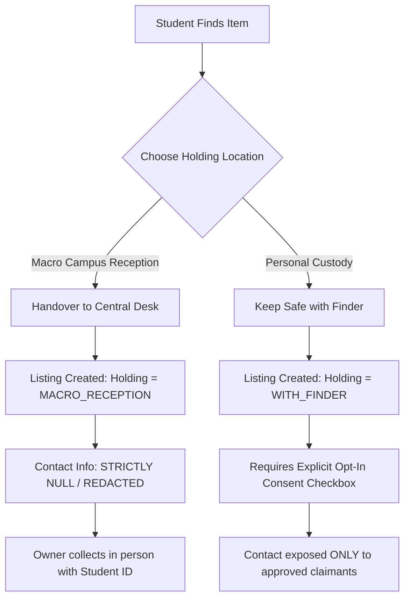

# CampusFind — College Lost & Found Platform

[](https://www.typescriptlang.org/)
[](https://react.dev/)
[](https://vitejs.dev/)
[](https://nodejs.org/)
[](https://expressjs.com/)
[](https://www.mongodb.com/)
[](https://tailwindcss.com/)
[](LICENSE)

CampusFind is a secure, privacy-first, and algorithmically powered Lost & Found web platform engineered for modern college campuses. It replaces chaotic, high-noise social messaging groups with a structured, verified, and automated recovery network.

---

## Table of Contents

- [Problem Statement](#problem-statement)
- [Key Features](#key-features)
- [5-Signal Deterministic Matching Engine](#5-signal-deterministic-matching-engine)
- [Privacy & Holding Rules Workflow](#privacy--holding-rules-workflow)
- [Architecture & Security Model](#architecture--security-model)
- [Technology Stack](#technology-stack)
- [Project Directory Structure](#project-directory-structure)
- [Pre-Seeded Demo Accounts](#pre-seeded-demo-accounts)
- [Getting Started](#getting-started)
  - [Prerequisites](#prerequisites)
  - [Quickstart with Root Monorepo Scripts](#quickstart-with-root-monorepo-scripts)
  - [Manual Service Launch](#manual-service-launch)
- [Environment Configuration](#environment-configuration)
- [Complete REST API Specification](#complete-rest-api-specification)
- [Production Security Invariants](#production-security-invariants)
- [Contributing & License](#contributing--license)

---

## Problem Statement

On university campuses, lost item announcements are typically broadcast over informal WhatsApp groups, Telegram channels, or bulletin boards:
- **Noisy & Ephemeral**: Important posts quickly drown under unrelated conversations and spam.
- **Privacy Exposure**: Students routinely post personal phone numbers, hostel names, and room numbers publicly, exposing themselves to harassment.
- **No Verification or Audit Trail**: Anyone can falsely claim high-value electronics without proving prior ownership.
- **Manual Matching**: Inquiries rely on chance observation rather than automated correlation between lost reports and found items.

**CampusFind** solves this with privacy-by-default listings, holding location rules (Central Safe Custody vs. Finder Custody), claim verification flows, in-app notifications, and deterministic match scoring.

---

## Key Features

- 🔍 **Public Guest Browsing**: Real-time filtering and search across categories, campus locations, date ranges, and statuses without requiring an account.
- 🛡️ **Privacy-By-Design**: Phone numbers and room numbers are redacted by default. Sensitive details are never leaked on lost-item reports.
- 🏢 **Conditional Holding Locations**:
  - **Macro Campus Central Reception**: Safe desk holding where zero student personal contacts are exposed. Claimants collect items directly from staff using their Student ID.
  - **With Finder (Personal Custody)**: Requires verified phone number, explicit opt-in consent, and only exposes contact details to approved claimants.
- 🤖 **5-Signal Deterministic Matching**: Automated correlation engine computes weighted similarities between lost and found items in real time.
- 🔐 **Dual-Token JWT & Rotating Sessions**: 15-minute access tokens coupled with 7-day rotating refresh tokens delivered via secure `HttpOnly`, `SameSite=Lax` cookies. Automatic session family invalidation upon reuse detection.
- 📋 **Claim & Verification System**: Claimants provide proof of ownership (serial numbers, lock screen wallpaper description, unique scratch marks). Finders review and approve or reject claims with reason notes.
- 📬 **In-App Notification Center**: Real-time unread badges and drawer for match alerts, claim approvals, and moderation actions without relying on third-party SMS or email providers.
- 👮 **Proctor & Moderation Hub**: Dedicated administrative panel for proctors to flag/hide listings, restore reports, suspend bad actors, and inspect tamper-evident audit logs.
- ⚡ **Zero-Config Developer Fallback**: Automatically spins up an embedded in-memory MongoDB database (`mongodb-memory-server`) with pre-seeded campus listings if no external `MONGODB_URI` is specified.

---

## 5-Signal Deterministic Matching Engine

When a report is filed or updated, CampusFind's matching engine evaluates all reciprocal active listings across 5 independent signals:

```text
┌─────────────────────────────────────────────────────────────┐
│                 5-Signal Matching Engine                    │
├─────────────────────┬────────────┬──────────────────────────┤
│ Signal              │ Weight     │ Evaluation Method        │
├─────────────────────┼────────────┼──────────────────────────┤
│ Category Match      │ 20% (0.20) │ Exact taxonomy match     │
│ Title & Description │ 30% (0.30) │ Normalized token overlap │
│ Campus Location     │ 20% (0.20) │ Location proximity & text│
│ Timeline Proximity  │ 15% (0.15) │ Event timestamp delta    │
│ Custom Attributes   │ 15% (0.15) │ Brand, color, model tags │
└─────────────────────┴────────────┴──────────────────────────┘
```

- **Dynamic Normalization**: When optional attributes are absent on both sides, the engine automatically renormalizes remaining weights so confidence scores remain statistically fair.
- **Match Notification**: Matches exceeding the minimum confidence threshold automatically generate match records and deliver in-app notifications to both users.

---

## Privacy & Holding Rules Workflow



---

## Architecture & Security Model

```text
Browser Client (Vite + React 18 + Tailwind CSS)
       │
       │ HTTP/REST (Credentials: 'include', HttpOnly Cookies)
       ▼
Express API Server (Port 4000)
       ├── Rate Limiting (express-rate-limit)
       ├── CORS Protection (Strict allowed origins)
       ├── authenticate Middleware (JWT verification + status check)
       ├── requireRole Middleware (STUDENT vs MODERATOR RBAC)
       ├── Privacy Sanitizer (Phone & room number masking)
       └── 5-Signal Matching Pipeline
       │
       ▼
Database Layer (Mongoose ORM)
       ├── MongoDB Atlas (Production)
       └── In-Memory MongoDB (Local Development Fallback)
```

### Security Guardrails
1. **No Client Trust for Identity**: `req.user.id` is extracted strictly from cryptographically verified JWT tokens. Client-supplied IDs are rejected.
2. **Strict Public Registration Role**: Public sign-up always assigns the `STUDENT` role. `MODERATOR` credentials cannot be registered via public endpoints.
3. **Session Revocation**: Suspending an account via the moderation panel immediately revokes all active auth sessions and refresh token families.
4. **Token Reuse Detection**: If an expired or already-rotated refresh token is re-submitted, the entire session family is flagged as compromised and revoked immediately.

---

## Technology Stack

### Frontend Client
- **Framework**: [React 18](https://react.dev/) with [TypeScript](https://www.typescriptlang.org/)
- **Bundler & Tooling**: [Vite 6](https://vitejs.dev/)
- **Styling**: [Tailwind CSS 3.4](https://tailwindcss.com/) with `clsx` and `tailwind-merge`
- **Icons**: [Lucide React](https://lucide.dev/)

### Backend Server
- **Runtime**: [Node.js (v18+)](https://nodejs.org/) with [Express 4](https://expressjs.com/)
- **Language**: [TypeScript](https://www.typescriptlang.org/) executed via [tsx](https://github.com/privatenumber/tsx)
- **Database & ODM**: [MongoDB](https://www.mongodb.com/) / [Mongoose 8](https://mongoosejs.com/)
- **In-Memory Database**: [mongodb-memory-server](https://github.com/nodkz/mongodb-memory-server) (for instant local development without MongoDB installation)
- **Authentication**: Signed JWTs ([jsonwebtoken](https://github.com/auth0/node-jsonwebtoken)), salted passwords ([bcryptjs](https://github.com/dcodeIO/bcrypt.js))
- **File Handling**: [Multer](https://github.com/expressjs/multer) with optional [Supabase Storage](https://supabase.com/storage) integration

---

## Project Directory Structure

```text
CampusFind/
├── package.json             # Root monorepo workspace orchestration
├── README.md                # Project documentation
├── client/                  # React + Vite frontend
│   ├── index.html
│   ├── package.json
│   ├── tsconfig.json
│   ├── vite.config.ts
│   └── src/
│       ├── App.tsx          # Router and application container
│       ├── main.tsx         # React root entry point
│       ├── index.css        # Tailwind styles & theme variables
│       ├── components/      # UI components (Navbar, Modals, Cards, Drawers)
│       ├── context/         # AuthContext and NotificationContext providers
│       ├── lib/             # API client and date utilities
│       ├── pages/           # HomePage, BrowsePage, CreateReport, Details, etc.
│       └── types/           # Shared TypeScript interfaces
└── server/                  # Express + TypeScript backend
    ├── package.json
    ├── tsconfig.json
    ├── uploads/             # Local multipart uploaded media files
    └── src/
        ├── app.ts           # Express application configuration & middlewares
        ├── server.ts        # Server bootstrap, security validation & listeners
        ├── config/          # Environment loader & database connector
        ├── middleware/      # Auth, role check, error handler middlewares
        ├── models/          # Mongoose models (User, Report, Claim, Match, etc.)
        ├── modules/         # Feature modules (Auth, Reports, Claims, Moderation)
        ├── seeds/           # Development database seeder with sample data
        └── services/        # Matching engine, session manager, file storage
```

---

## Pre-Seeded Demo Accounts

When running in development mode, the database automatically initializes with sample listings and the following pre-configured credentials:

| Role | Email | Password | Assigned Name / Department |
|---|---|---|---|
| **Student (Reporter)** | `student@campus.edu` | `Password123!` | Alex Sharma (Uniworld 1, Rm 304) |
| **Student (Finder)** | `finder@campus.edu` | `Password123!` | Priya Patel (Uniworld 2, Rm 112) |
| **Moderator (Proctor)** | `moderator@campus.edu` | `AdminSecret123!` | Chief Proctor Office (Admin-201) |

> 💡 **Quick Login Tip**: The sign-in modal in the frontend includes one-click buttons to instantly autofill these demo accounts.

---

## Getting Started

### Prerequisites
- **Node.js**: v18.0.0 or higher
- **npm**: v9.0.0 or higher
- *(Optional)* A free [MongoDB Atlas](https://www.mongodb.com/atlas) cluster URI (leave blank to run in-memory).

---

### Quickstart with Root Monorepo Scripts

1. **Clone the repository:**
   ```bash
   git clone https://github.com/abhinavgit301/CampusFind.git
   cd CampusFind
   ```

2. **Install all dependencies:**
   ```bash
   # Install server dependencies
   cd server && npm install
   # Install client dependencies
   cd ../client && npm install
   cd ..
   ```

3. **Start both backend and frontend:**
   Open two terminal windows in the project root:

   **Terminal 1 (Backend API - Port 4000):**
   ```bash
   npm run dev:server
   ```

   **Terminal 2 (Frontend Client - Port 5173):**
   ```bash
   npm run dev:client
   ```

4. **Access the application:**
   Navigate to **`http://localhost:5173`** in your browser.

---

### Manual Service Launch

You can also run commands directly from the respective service folders:

#### Backend
```bash
cd server
npm run dev
# Optional: re-run seed manually
npm run seed
```

#### Frontend
```bash
cd client
npm run dev
```

---

## Environment Configuration

Create a `.env` file inside `server/` (or copy from the defaults below):

### `server/.env`
```env
# Application Environment ('development' | 'production')
NODE_ENV=development
PORT=4000

# Client Application URL (for CORS and cookie origin matching)
APP_ORIGIN=http://localhost:5173

# Database Connection
# Leave empty in development to automatically use the embedded in-memory database
MONGODB_URI=

# JWT Authentication Settings
JWT_ISSUER=campusfind-api
JWT_AUDIENCE=campusfind-web
JWT_ACCESS_TTL_SECONDS=900
JWT_ACCESS_SECRET=campusfind_super_secure_access_secret_key_2026_xyz!

# Refresh Session Longevity
REFRESH_TOKEN_TTL_DAYS=7

# Optional Cloud Storage (defaults to local /uploads/ directory)
SUPABASE_URL=
SUPABASE_SERVICE_ROLE_KEY=
SUPABASE_BUCKET=campusfind-photos
```

---

## Complete REST API Specification

All API endpoints are prefixed with `/api/v1` unless noted otherwise.

### Authentication & Profile (`/api/v1/auth` & `/api/v1/me`)
| Method | Endpoint | Access | Description |
|---|---|---|---|
| `POST` | `/api/v1/auth/register` | Public | Register a new student account (`STUDENT` role) |
| `POST` | `/api/v1/auth/login` | Public | Authenticate user, issue access JWT & set refresh cookie |
| `POST` | `/api/v1/auth/refresh` | Public (Cookie) | Rotate refresh token and issue new access JWT |
| `POST` | `/api/v1/auth/logout` | Authenticated | Revoke refresh session and clear authentication cookies |
| `GET` | `/api/v1/me` | Authenticated | Fetch current authenticated user profile |
| `PATCH` | `/api/v1/me` | Authenticated | Update user profile (phone, hostel, room number) |

### Listings & Reports (`/api/v1/reports`)
| Method | Endpoint | Access | Description |
|---|---|---|---|
| `GET` | `/api/v1/reports` | Public | Search & list reports with type, category, and date filters |
| `GET` | `/api/v1/reports/:publicId` | Public | Fetch public details of a single report (sanitized) |
| `POST` | `/api/v1/reports` | Authenticated | Create a new `LOST` or `FOUND` item report |
| `PATCH` | `/api/v1/reports/:publicId` | Author/Mod | Update existing listing metadata |
| `POST` | `/api/v1/reports/:publicId/withdraw` | Author/Mod | Withdraw listing from public board |
| `POST` | `/api/v1/reports/:publicId/confirm-recovery`| Author/Finder | Mark item as successfully recovered and close report |
| `GET` | `/api/v1/reports/me/reports` | Authenticated | List all reports created by the current user |

### Claim Submissions (`/api/v1`)
| Method | Endpoint | Access | Description |
|---|---|---|---|
| `POST` | `/api/v1/reports/:publicId/claims` | Authenticated | Submit ownership claim with proof description |
| `GET` | `/api/v1/reports/:publicId/claims` | Report Author | View all claims submitted against user's report |
| `GET` | `/api/v1/me/claims` | Authenticated | View all claims filed by the current user |
| `PATCH` | `/api/v1/claims/:id/review` | Report Author | Approve or reject an ownership claim |

### Matches & Notifications (`/api/v1`)
| Method | Endpoint | Access | Description |
|---|---|---|---|
| `GET` | `/api/v1/me/matches` | Authenticated | Fetch automated 5-signal suggestions for user's reports |
| `GET` | `/api/v1/me/notifications` | Authenticated | Get user notifications and current unread counter |
| `POST` | `/api/v1/me/notifications/:id/read` | Authenticated | Mark an individual notification as read |
| `POST` | `/api/v1/me/notifications/read-all` | Authenticated | Mark all user notifications as read |

### Proctor & Moderation (`/api/v1/admin`)
| Method | Endpoint | Access | Description |
|---|---|---|---|
| `GET` | `/api/v1/admin/reports` | `MODERATOR` | Fetch full report catalogue including hidden/flagged posts |
| `PATCH` | `/api/v1/admin/reports/:publicId/moderation` | `MODERATOR` | Hide (`UNDER_REVIEW`) or restore a listing |
| `PATCH` | `/api/v1/admin/users/:userId/status` | `MODERATOR` | Suspend or reactivate user account (revokes sessions) |
| `GET` | `/api/v1/admin/analytics` | `MODERATOR` | Fetch platform statistics and recent audit activity logs |

### Static & Utilities
| Method | Endpoint | Access | Description |
|---|---|---|---|
| `GET` | `/api/health` | Public | Healthcheck and server availability monitor |
| `GET` | `/api/v1/categories` | Public | Fetch supported campus item categories list |
| `GET` | `/api/v1/locations` | Public | Fetch official university zones and hostels list |
| `POST` | `/api/v1/upload` | Authenticated | Multipart image upload for item photographs |

---

## Production Security Invariants

The backend performs automated startup validation in `validateSecurityConfig()`:
1. **Mandatory Production Database**: In `production` mode, `MONGODB_URI` cannot be empty. In-memory databases are strictly prevented from launching in production.
2. **Cryptographic Key Strength**: Development fallback secrets are rejected at startup in `production`. The server enforces a cryptographically strong `JWT_ACCESS_SECRET` with a minimum length of 32 characters.
3. **Database Seeding Guard**: Automatic database deletion and reseeding is locked out in production to safeguard live campus data.

---

## Contributing & License

Contributions, bug reports, and feature requests are welcome!

1. Fork the Project
2. Create your Feature Branch (`git checkout -b feature/AmazingFeature`)
3. Commit your Changes (`git commit -m 'feat: Add AmazingFeature'`)
4. Push to the Branch (`git push origin feature/AmazingFeature`)
5. Open a Pull Request

Distributed under the **MIT License**. See `LICENSE` for details.
